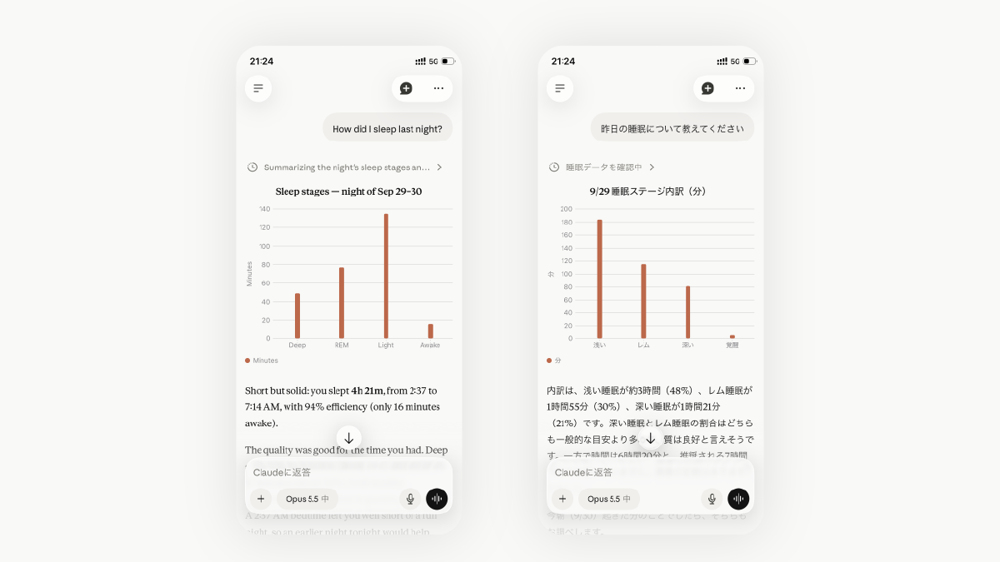
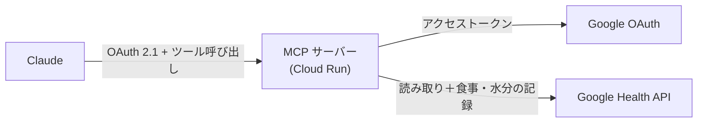
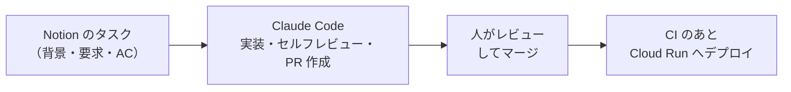

# google-health-mcp



**Google Fitbit Air の健康データを Google Health API 経由で Claude から呼び出し、食事・水分を記録できるリモート MCP サーバー。**

[](https://github.com/ryotanakata/google-health-mcp/actions/workflows/ci.yml)


[English README](README.md)

---

Claude に「昨日の睡眠はどうだった？」と聞くと、このサーバーが Google Health API からデータを取り、要約して返す。「お昼に親子丼を食べた」と話せば食事のログに記録する。Fitbit・Pixel Watch のデータも同じように扱える。

## 構成



- サーバー自身が Claude 向けの OAuth 2.1 認可サーバーを兼ねる。同意画面でパスフレーズ（`MCP_SHARED_SECRET`）を入力したときだけトークンを発行する
- 状態を持たない。トークンは署名付き JWT なので DB は不要
- 生の時系列データではなく、要約を返す
- 書き込めるのは食事と水分だけで、ほかのデータ型は読み取り専用

## MCP ツール

| ツール | 引数 | 返却内容 |
| --- | --- | --- |
| `get_daily_activity` | `date` | 歩数・消費カロリー・移動距離・アクティブ時間・上った階数・アクティブゾーン時間 |
| `get_sleep_log` | `date` | その日の朝に終わった睡眠：睡眠時間・効率・ステージ・仮眠 |
| `get_heart_rate_summary` | `date` | 安静時心拍数・moderate / vigorous / peak ゾーンの滞在時間とその合計 |
| `get_exercise_history` | `start_date`, `end_date` | ワークアウト：種目・時間・カロリー・平均心拍・距離 |
| `get_health_metrics` | `date` | 心拍変動・呼吸数・SpO2・皮膚温と基準値・VO2 Max |
| `get_body_measurements` | `start_date`, `end_date` | 体重・体脂肪率：期間の最初・最後・最小・最大・平均と、日別の値 |
| `get_activity_trend` | `start_date`, `end_date` | 日別の活動量と安静時心拍数、期間の合計・平均 |
| `get_nutrition_log` | `date` | その日の食事・水分：合計（kcal・PFC・ml）と、記録ごとの内容と `name` |
| `get_devices` | — | ペアリング済みデバイスごとの製品名・種類・バッテリー・最終同期時刻 |
| `log_meal` | `meal_type`, `items`, `date?`, `time?` | 1回の食事を記録する。品目ごとに1件ずつ書き、その `name` を返す |
| `log_water` | `amount_ml`, `date?`, `time?` | 水分を ml で記録し、その `name` を返す |
| `delete_nutrition_logs` | `names` | `get_nutrition_log` が返した `name` で食事・水分の記録を削除する |

日付は `YYYY-MM-DD`。期間は両端を含み、上限は `get_exercise_history` が366日、`get_body_measurements` と `get_activity_trend` が90日。記録系の `date`（`YYYY-MM-DD`）と `time`（`HH:MM`）を省略すると、`NUTRITION_LOG_TIME_ZONE`（`Asia/Tokyo`）の現在時刻になる。

## データ取得の制約

- 1リクエストの期間は最大90日（心拍・カロリーの複数日集計は14日）。長い期間は分割して取得・結合する
- 結果はページ単位（ワークアウト・睡眠は1ページ25件）で、最後まで取得する
- 心拍ゾーンの light は返さない。日次集計は1日の全時間をどれかのゾーンに振り分けるため、light には睡眠・安静・未装着の時間も入る
- アクティブゾーン時間は実時間の分数ではない。cardio と peak は1分あたり2、fat burn は1が加算される。ゾーンごとの滞在時間が必要なときは `get_heart_rate_summary` を使う
- `get_health_metrics` の指標は主に睡眠中に計測されるため、未装着の夜はエラーではなく `null` になる。日付は API がその夜に記録した日付で、`get_sleep_log` と同じ夜になるかは未確認
- `get_body_measurements` は1日1件（その日の最後の記録）を、記録があった日だけ返す
- Google 独自のスコア（睡眠スコア、Daily Readiness）は API では取得できない
- 睡眠・ワークアウトの開始・終了時刻は、各セッションに記録された現地時刻で返す
- 食事は匿名方式（`foodDisplayName` と渡された栄養素）で記録する。API に食品名で検索する filter が無いため。**匿名方式の記録は編集できない**ので、直すときは削除して記録し直す
- `log_meal` の kcal・PFC は呼び出し側が渡す。サーバーは栄養価を調べない
- 書き込みには `googlehealth.nutrition.writeonly`、Fitbit アプリで記録した食事の読み取りには `googlehealth.nutrition.readonly` が要る。refresh_token にスコープが付くまで、食事・水分・デバイスのツールは取り直しを促す 403 を返す
- 食事・水分・デバイスのツールは実機での確認が未了。ほかのツールは確認済み
- 実機（Google Fitbit Air のアカウント）で動作を確認済み。Google Health Premium の契約は前提にしていないが、契約なしで全データ型を取得できるかは未確認。Fitbit Air が `get_health_metrics` の各指標と階数を実際に記録するかも未確認

## クイックスタート

先に OAuth クライアントを作り、`client_secret.json` を用意する（[docs/deployment.ja.md](docs/deployment.ja.md) の手順1〜2）。

```bash
pip install -r requirements-dev.txt
cp .env.example .env                                     # 値を設定する
python auth_setup.py --client-secret client_secret.json  # GOOGLE_REFRESH_TOKEN を取得
python -m src.main                                       # http://localhost:8080/mcp
```

| 変数 | 説明 |
| --- | --- |
| `PUBLIC_BASE_URL` | サーバーの公開オリジン |
| `MCP_SHARED_SECRET` | 同意画面のパスフレーズ（長いランダム値） |
| `MCP_TOKEN_SIGNING_KEY` | トークンの署名鍵（32文字以上のランダム値。パスフレーズとは別の値にする。変更すると全トークンが無効になる） |
| `GOOGLE_CLIENT_ID` / `GOOGLE_CLIENT_SECRET` | GCP の OAuth クライアント |
| `GOOGLE_REFRESH_TOKEN` | `auth_setup.py` の出力 |

## デプロイ

1. Google Cloud で Google Health API を有効化し、`GOOGLE_HEALTH_SCOPES` のスコープで OAuth 同意画面を設定して `client_secret.json` を取得する
2. ローカルで `auth_setup.py` を実行し、秘密情報を Secret Manager に登録する
3. `PUBLIC_BASE_URL` にサービスの URL（`https://<サービス名>-<プロジェクト番号>.<リージョン>.run.app`）を設定して Cloud Run にデプロイする
4. Claude の Settings → Connectors → Add custom connector に `https://<サービス>.run.app/mcp` を登録し、同意画面でパスフレーズを入力する

同意画面が「テスト」のままだと Google の refresh_token は7日で失効するので、`scripts/refresh_google_token.sh` で更新する。コマンド付きの手順、main へのマージでの継続的デプロイ、トークンの更新は [docs/deployment.ja.md](docs/deployment.ja.md) にある。

## 開発

```bash
ruff check .
pytest
```

タスクを Notion に書き、Claude Code が実装し、人がレビューしてマージする。仕組みは `.claude/` にある:



- `rules/`: コーディング規約。`rules-review` スキルが変更ファイルを照合し、通過していないコミットはフック（`hooks/review-gate.sh`）が止める
- `routine-prompt.md`: 定期実行のルーチン用プロンプト。1回に1件、自分の PR の CI 失敗・レビューコメントへの対応を優先し、無ければ `notion.json` の Notion データベースから新しいタスクを取る
- `skills/ship/`: レビュー・コミット・PR 作成を一括で行う

## ライセンス

MIT
